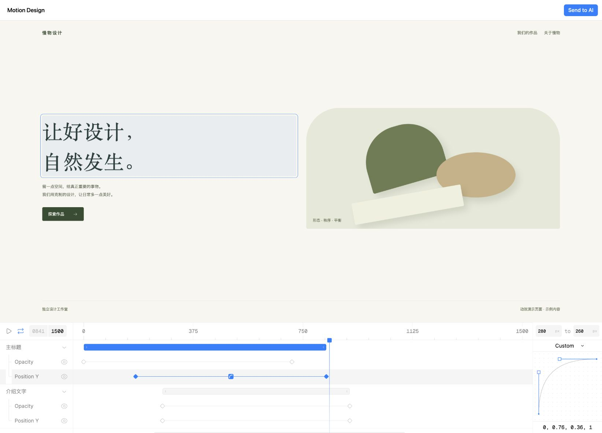

# Motion Desk

**为 AI 编程协作设计的可视化网页动效编辑器。**

用 AI 做网页时，动效的细节往往很难只靠对话调准：标题要提前多少毫秒出现，按钮要慢一点还是快一点，曲线应该怎么变，通常需要来回描述和修改。

Motion Desk 让你在真实网页预览旁，直接拖动时间轴、调整关键帧和缓动曲线。调到满意后，把确定的参数交回 AI，由 AI 修改项目代码。

**AI 做初版 → 你在界面中精调 → AI 把结果写回代码。**



## 能做什么

- **预览真实网页**：一边看项目页面，一边调整动效，播放和拖动时间轴时实时查看效果。
- **控制动画时序**：分别调整透明度、位置和缩放的开始时间、时长与关键帧；也能整组平移或缩放时间范围。
- **精调缓动曲线**：选择曲线预设、拖动贝塞尔控制点，或直接输入控制值。
- **同时调整多条轨道**：按住 Shift 跨元素多选，一起拖动并保留相对时序。
- **把结果交给 AI**：查看修改差异、确认参数，再让 AI 应用到源码；支持自动保存、撤销、重做和 JSON 导出。

支持安装到 **Codex** 和 **Claude Code**。Codex 在具备侧面板能力时可在对话旁打开编辑器；Claude Code 通过浏览器打开。

## 安装

准备好 Node.js 20 或更新版本、npm，以及你使用的 Codex 或 Claude Code。

```sh
git clone https://github.com/javaon0120/motion-desk.git
cd motion-desk
npm ci
npm run setup
```

按提示选择要安装到的 Agent：

```text
1. Codex
2. Claude Code
3. 两者都安装
```

向导会配置工具连接和使用技能，安装后可在所选 Agent 的所有本地项目中使用。完成后重启 Agent 或开启新会话。

安装问题、指定安装目标和更新方法见 [安装指南](docs/installation.md)。

## 如何使用

### 1. 让 AI 接入你的网页

在你正在开发的网页项目里，对 Agent 说：

> 用 Motion Desk 调整首页的入场动效。把标题、介绍文字和按钮接入编辑器，并帮我打开工作台。

AI 会读取已有动画，接入项目的开发页面并启动编辑器。网页接入、场景注册和参数读取由 AI 完成。

### 2. 在界面中调整

编辑器上方是网页预览，下方是时间轴，右侧是参数面板。

| 想调整什么 | 怎么操作 |
| --- | --- |
| 动画何时开始 | 拖动属性轨道的线段 |
| 某个节点的时间 | 拖动菱形关键帧 |
| 整个元素的节奏 | 拖动父级时间条，或拉伸它的两端 |
| 同时移动多条动画 | 按住 Shift 点击多选，再一起拖动 |
| 起止位置、透明度或缩放 | 选中属性，在右侧输入起止值 |
| 加速、减速的感觉 | 选择缓动预设，或拖动曲线控制点 |

按空格播放或暂停，边看效果边调整。完整操作和快捷键见 [编辑器使用指南](docs/usage.md)。

### 3. 确认并交给 AI

点击右上角 **Send to AI**，查看差异并选择 **保存并发送**。

工作台会保存这次确认的参数。宿主支持直接回传时，交接内容会发送到对话；在普通浏览器中，将复制的交接内容粘贴回 Agent，告诉它：

> 按这个确认版本，把动效参数应用到项目代码。

AI 会读取确认版本，修改对应源码并验证效果。

## 先试一下

想先了解编辑器，可以在安装依赖后运行内置示例：

```sh
npm start
```

打开 [本地示例](http://127.0.0.1:4318)，即可调整示例网页的标题、文字、按钮和展示区域。

## 当前支持范围

当前为 **0.2.0 Demo**，适合开发中的网页动效精调，支持透明度、X/Y 位置、缩放、关键帧和三次贝塞尔缓动。

接入自己的页面需要由 AI 注册要编辑的动画，并加载开发预览桥接脚本。暂不支持自动提取任意网站的动画，以及物理弹簧、滚动联动、路径动画或布局动画。

## 更多文档

- [安装指南](docs/installation.md)：Agent 安装、更新与常见问题。
- [编辑器使用指南](docs/usage.md)：时间轴、参数、快捷键、保存与交接。
- [项目接入指南](docs/integration.md)：真实网页接入、场景格式与坐标定义，供 AI 和开发者参考。
- [开发指南](docs/development.md)：本地开发、测试、MCP 工具与其他宿主接入。
